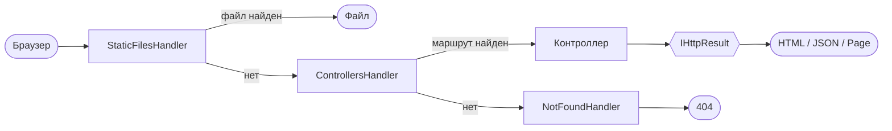
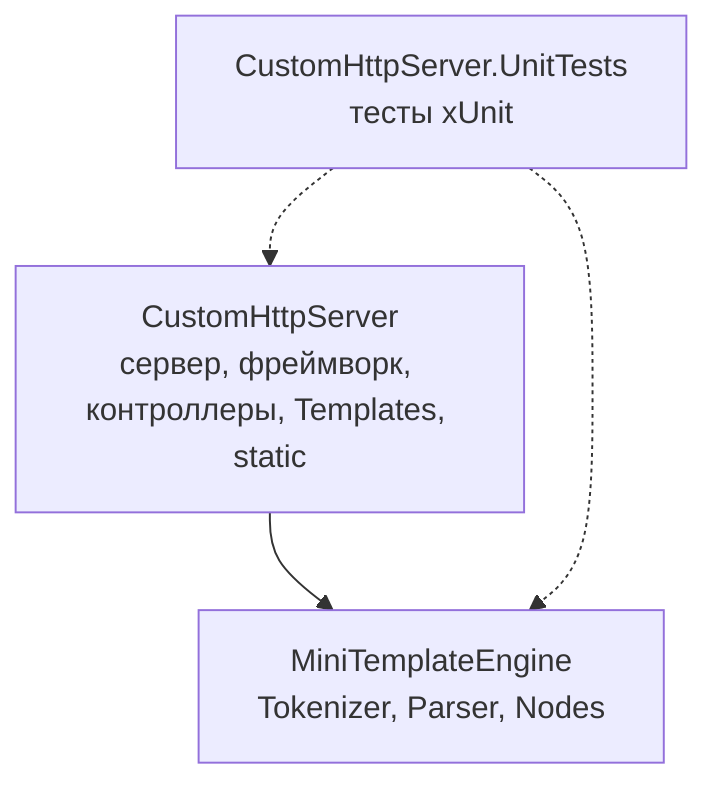

<div align="center">

# 🌐 ORIS · HTTP-сервер на C#

**Собственный веб-фреймворк на `HttpListener`: от первой страницы до шаблонизатора и модульных тестов**


[О проекте](#-о-проекте) ·
[Задания](#-домашние-задания) ·
[Архитектура](#-архитектура) ·
[Шаблонизатор](#-шаблонизатор) ·
[Запуск](#-запуск) ·
[Тесты](#-тесты)

</div>

---

## 📖 О проекте

Репозиторий с домашними заданиями по курсу **ОРИС**. Каждая работа добавляет новый слой к одному и тому же проекту: простой сервер → статика → маршрутизация → контроллеры → собственный HTML-шаблонизатор → тесты.

Ни ASP.NET, ни готовых шаблонизаторов: всё написано вручную, чтобы понять, как устроены современные веб-фреймворки изнутри.

## 🗂 Домашние задания

| № | Тема | Что реализовано |
|:-:|------|-----------------|
| [1](HomeWork_1) | **Вёрстка сайта** | Статическая вёрстка «Страницы поиска» (search-engine) и сайта HTML Knowledge на HTML и CSS |
| [2](HomeWork_2) | **HttpListener** | Первый HTTP-сервер на C#: запуск по адресу из настроек, отдача страницы поиска |
| [3](HomeWork_3) | **Статические файлы** | Раздача файлов из `static`, `Content-Type` по расширению (`MimeTypeProvider`) |
| [4](HomeWork_4) | **Параметры из query** | Эндпоинты-методы, преобразование параметров в типы C#, обработка ошибок (400, 404, 405, 500) |
| [5](HomeWork_5) | **Почта и маршрутизация** | Атрибуты `[Controller]`, `[Get]`, `[Post]`, цепочка обработчиков, отправка письма по SMTP, тело POST-формы |
| [6](HomeWork_6) | **Контроллеры и результаты** | `BaseController`, `IHttpResult`, `HtmlResult`, `JsonResult`, `TextResult`, HTTP-статусы, доступ к контексту запроса |
| [7](HomeWork_7) | **HTML-шаблонизатор** | Собственная библиотека: переменные, `$if`, `$foreach`, вложенность, HTML-кодирование, понятные ошибки |
| [8](HomeWork_8) | **Тесты** | Модульные тесты xUnit для шаблонизатора и фреймворка, рефакторинг ради тестируемости |

## ⚙️ Возможности

- 🔗 **Маршрутизация через атрибуты**: имя берётся из класса или метода, если не задано явно
- ⛓ **Цепочка обработчиков** (Chain of Responsibility): статика → контроллеры → 404
- 📦 **Привязка параметров** из Query и тела формы (`int`, `bool`, `enum`, `Guid` и др.)
- 📤 **Единый механизм ответов** через `IHttpResult`: `Html()`, `Json()`, `Text()`, `Page()`
- 🧩 **Шаблонизатор** как независимая библиотека
- 🛡 **Безопасность**: HTML-кодирование значений, клиент не видит внутренних ошибок и секретов
- ✅ **Тесты** без сети, SMTP и запуска сервера

## 🏗 Архитектура

### Путь запроса



### Структура решения



```text
Решение/
├── CustomHttpServer/             # приложение и HTTP-фреймворк
│   ├── Framework/                # HttpServer, Handlers, Results, Routing, Attributes
│   ├── Controllers/              # Test, Auth, User
│   ├── Services/                 # EmailService
│   ├── Templates/                # HTML-шаблоны
│   └── static/                   # статические сайты
├── MiniTemplateEngine/           # шаблонизатор (Tokenizer, Parser, Nodes)
└── CustomHttpServer.UnitTests/   # тесты шаблонизатора и фреймворка
```

Шаблонизатор ни от чего не зависит: его можно использовать в любом другом проекте.

## 🧩 Шаблонизатор

```html
<h1>${User.Name}</h1>

$if(User.IsActive)
    <p>Пользователь активен</p>
$else
    <p>Пользователь неактивен</p>
$endif

<ul>
$foreach(var course in Courses)
    <li>${course.Name}
        $if(course.Passed) ✅ $else ⏳ $endif
    </li>
$endfor
</ul>
```

| Конструкция | Назначение |
|-------------|-----------|
| `${Object.Property}` | Подстановка значения с HTML-кодированием |
| `$if(Flag)` · `$if(!Flag)` | Условие и его отрицание |
| `$else` · `$endif` | Альтернативная ветка и конец условия |
| `$foreach(var x in Items)` · `$endfor` | Цикл по коллекции |

Конструкции вкладываются друг в друга в любом порядке.

<details>
<summary>🚨 <b>Понятные сообщения об ошибках шаблона</b></summary>

<br>

| Проблема в шаблоне | Сообщение |
|--------------------|-----------|
| Нет `$endif` | `Строка 1: не найден $endif для $if(IsActive).` |
| Нет `$endfor` | `Строка 1: не найден $endfor для $foreach(var x in Items).` |
| Лишний `$endif` | `Строка 1: неожиданная конструкция: $endif без соответствующего $if.` |
| Неверный `$foreach` | `Строка 1: некорректная конструкция $foreach(x of Items). Ожидается $foreach(var item in Items).` |
| Нет свойства | `Строка 3: свойство 'Nope' не найдено в типе '...'.` |

Клиент при этом видит только `500 Internal server error`, а подробная причина печатается в консоль сервера.

</details>

## 🚀 Запуск

```bash
git clone https://github.com/cloud3r/ORIS.git
cd ORIS/HomeWork_8

dotnet build
dotnet run --project CustomHttpServer
```

Сервер стартует по адресу из `settings.json` (по умолчанию `http://127.0.0.1:8888/`). Остановка: введите `stop` в консоли.

### Примеры запросов

| Запрос | Результат |
|--------|-----------|
| `GET /test/index` | HTML-страница |
| `GET /test/info` | JSON |
| `GET /test/requestinfo` | JSON: метод, путь, `User-Agent` |
| `GET /user/profile` | Страница профиля из шаблона |
| `GET /user/list` | Список пользователей: `$foreach` + `$if` |
| `POST /auth/send` | Отправка письма, ответ `{"success": true, "message": "..."}` |

<details>
<summary>📧 <b>Настройка почты</b></summary>

<br>

Файл `secret.json` в репозиторий **не попадает**. Создайте его по образцу `secret.example.json`:

```json
{
  "Smtp": {
    "Host": "smtp.mail.ru",
    "Port": 587,
    "User": "your-email@mail.ru",
    "Pass": "app-password"
  }
}
```

Используйте пароль для внешнего приложения, а не пароль от ящика.

</details>

## 🧪 Тесты

```bash
dotnet test
```

Покрыто: подстановка переменных, условия, циклы, вложенность, чтение и запись файлов, ошибки шаблонов, поиск контроллеров, HTTP-методы, привязка параметров Query и Body, JSON и HTML результаты, `PageResult` с подставным рендерером, передача управления между обработчиками.

Тесты изолированы: файловые проверки работают во временных папках и убирают за собой.

## 🛠 Технологии


---

<div align="center">

Учебный проект по курсу ОРИС · группа 11-507

</div>